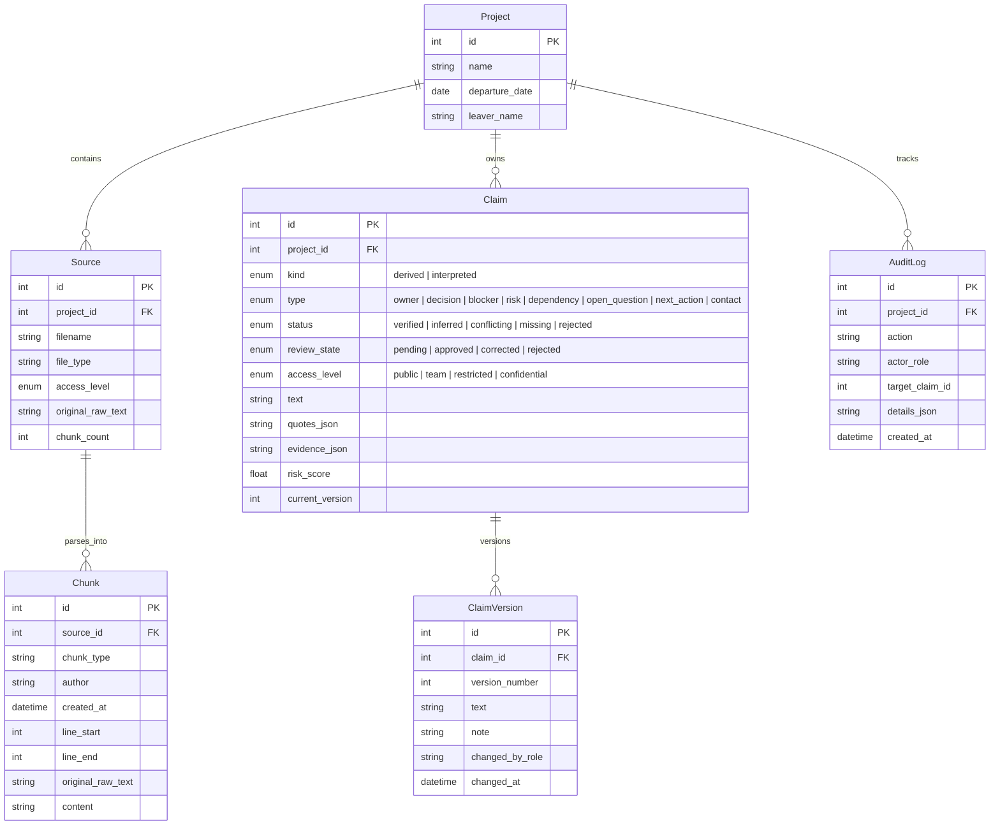
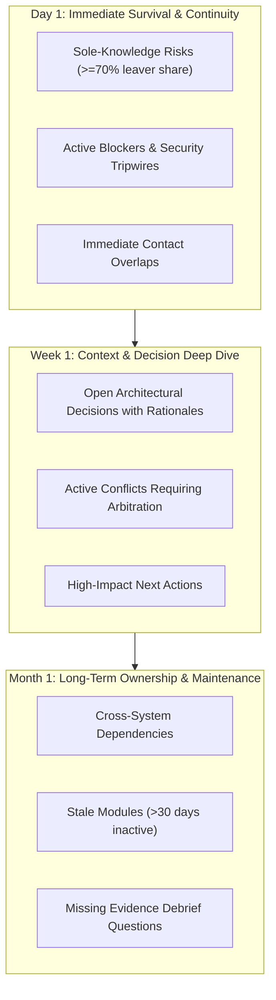

# Backstop — Comprehensive Project Documentation & Technical Specification

> **Every claim shows its source quote and a status. A human approves before handover.**  
> *A deterministic transition intelligence platform that turns unstructured developer activity into an auditable, role-gated handover ledger.*

---

## Table of Contents
1. [Executive Summary & Problem Statement](#1-executive-summary--problem-statement)
2. [Core Principles & Architecture Philosophy](#2-core-principles--architecture-philosophy)
3. [System Architecture & Data Flow](#3-system-architecture--data-flow)
4. [Data Models & Schema Design](#4-data-models--schema-design)
5. [Component Deep-Dive](#5-component-deep-dive)
   - [5.1 Ingestion & Chunking (`ingest.py`)](#51-ingestion--chunking-ingestpy)
   - [5.2 Pre-LLM Redaction Barrier (`redact.py`)](#52-pre-llm-redaction-barrier-redactpy)
   - [5.3 Plain-Code Derivations Engine (`derived.py`)](#53-plain-code-derivations-engine-derivedpy)
   - [5.4 Multi-Provider LLM & Disk Cache (`llm.py`)](#54-multi-provider-llm--disk-cache-llmpy)
   - [5.5 Two-Tier Verification Engine (`verify.py`)](#55-two-tier-verification-engine-verifypy)
   - [5.6 Human Review & Audit Trail (`review.py`)](#56-human-review--audit-trail-reviewpy)
   - [5.7 Role-Gated Views & Phased Planning (`views.py`)](#57-role-gated-views--phased-planning-viewspy)
   - [5.8 Empirical Backtesting Engine (`backtest.py`)](#58-empirical-backtesting-engine-backtestpy)
6. [Role-Based Access Control & Security Model](#6-role-based-access-control--security-model)
7. [Deterministic Phased Transition Plan (Day 1 / Week 1 / Month 1)](#7-deterministic-phased-transition-plan-day-1--week-1--month-1)
8. [API Endpoint Reference](#8-api-endpoint-reference)
9. [Frontend Application Architecture](#9-frontend-application-architecture)
10. [Automated Testing Suite (113 Tests) & Quality Assurance](#10-automated-testing-suite-113-tests--quality-assurance)
11. [Deployment, Configuration & Operations](#11-deployment-configuration--operations)
12. [Transparency, Limitations & Future Roadmap](#12-transparency-limitations--future-roadmap)

---

## 1. Executive Summary & Problem Statement

### 1.1 The Information Cliff in Engineering Offboarding
When an experienced engineer or technical lead leaves a software organization, teams experience an abrupt loss of context commonly called the **Information Cliff**:
- **Stale Documentation**: Internal Confluence, Notion, and README pages are frequently months or years out of date.
- **Tribal Knowledge**: Critical operational behaviors (such as secret rotation schedules, fragile deployment steps, unmerged branches, or database failover caveats) exist only in the leaver's memory.
- **Guess-Filled Onboarding**: Replacement engineers spend weeks guessing why past architectural decisions were made, often accidentally triggering regressions or repeating abandoned experiments.
- **Privacy & Security Hazards**: Handovers routinely involve unredacted pastes of Slack chats, credentials, or private HR meeting notes, risking leaks across role boundaries.

### 1.2 Backstop's Solution
**Backstop** eliminates the offboarding cliff by continuously analyzing unstructured developer trails (**git commit logs, GitHub/Jira issues and comments, markdown meeting notes, spreadsheet task trackers, and chat threads**) and distilling them into a **structured, verified, and role-gated Claim Ledger**.

Rather than relying on unconstrained LLM summarization—which is prone to hallucinations and unsupported claims—Backstop enforces a dual-track architecture:
1. **Mathematical Derivations**: Module ownership, sole-knowledge risks, staleness, and contributor overlaps are calculated strictly with deterministic, plain Python code.
2. **Double-Verified Extractions**: All qualitative claims (decisions, reasons, blockers, dependencies, open questions) require verbatim substring quotes extracted from raw sources and corroborated by secondary support checks.

---

## 2. Core Principles & Architecture Philosophy

Backstop was engineered from the ground up around four foundational safety rules:

```
+---------------------------------------------------------------------------------------+
|                                BACKSTOP SAFETY PILLARS                                |
+---------------------------------------------------------------------------------------+
|  1. Plain-Code Derivations   | Code ownership & risk metrics never touch an LLM.      |
|  2. Exact Substring Quotes   | Every qualitative claim must cite an exact quote.      |
|  3. Pre-LLM Masking Barrier  | Credentials and personal data are masked before AI.    |
|  4. Strict Access Gating     | Claims inherit the strictest citation access level.    |
+---------------------------------------------------------------------------------------+
```

1. **Deterministic Plain-Code Calculations**:
   Metrics such as "who owns this module", "is this module a single-point-of-failure risk", and "when was this area last touched" are mathematical properties of version control and issue histories. An LLM is never permitted to guess code metrics.
2. **Double-Checked Evidence Verification**:
   No LLM-generated statement enters the ledger unless its supporting quote exists character-for-character inside the original raw chunk text. If an LLM hallucinates or alters a single word of a quote, the claim is immediately rejected.
3. **Pre-LLM Privacy & Secret Redaction**:
   All raw text passes through regex-based credential and PII scrubbers before touching any language model API or disk cache. Passwords, private keys, API tokens, emails, and phone numbers are scrubbed at the perimeter.
4. **Strictest-Citation Access Inheritance**:
   A claim's access level (`public`, `team`, `restricted`, `confidential`) is strictly governed by the maximum access level of the chunks it cites. Lower-privileged roles receive locked placeholders with zero text or quote disclosure.
5. **Human-in-the-Loop Review**:
   AI and code derivations create *candidate claims*. An engineering lead or administrator reviews, edits (bumping versions), or rejects claims with an immutable audit trail before they appear in the final handover dossier.

---

## 3. System Architecture & Data Flow

```
                                      [RAW REPOSITORY DATA]
                          ┌─────────────────────┼─────────────────────┐
                          │                     │                     │
                    git_log.txt            issues.json            notes/*.md
                   (~220 commits)        (~40 issues+cmts)       (~10 meetings)
                          │                     │                     │
                          └─────────────────────┼─────────────────────┘
                                                │
                                                ▼
                                    ┌───────────────────────┐
                                    │ INGEST & CHUNKING     │
                                    │ (ingest.py)           │
                                    └───────────┬───────────┘
                                                │
                     ┌──────────────────────────┴──────────────────────────┐
                     │                                                     │
                     ▼                                                     ▼
        ┌─────────────────────────┐                           ┌─────────────────────────┐
        │ PLAIN-CODE ENGINE       │                           │ REDACTION BARRIER       │
        │ (derived.py)            │                           │ (redact.py)             │
        │ - Git commit ownership  │                           │ - Strip API keys        │
        │ - Sole knowledge risks  │                           │ - Mask PII & passwords  │
        │ - Staleness factors     │                           └────────────┬────────────┘
        │ - Reverted commits      │                                        │
        └────────────┬────────────┘                                        ▼
                     │                                        ┌─────────────────────────┐
                     │                                        │ LLM CLAIM EXTRACTION    │
                     │                                        │ (llm.py)                │
                     │                                        │ - Gemini / Claude / GPT │
                     │                                        │ - Deterministic Cache   │
                     │                                        └────────────┬────────────┘
                     │                                                     │
                     │                                                     ▼
                     │                                        ┌─────────────────────────┐
                     │                                        │ TWO-TIER VERIFICATION   │
                     │                                        │ (verify.py)             │
                     │                                        │ 1. Substring Quote Test │
                     │                                        │ 2. Support Corroboration│
                     │                                        │ 3. Conflict Detection   │
                     │                                        └────────────┬────────────┘
                     │                                                     │
                     └──────────────────────────┬──────────────────────────┘
                                                │
                                                ▼
                                    ┌───────────────────────┐
                                    │ CLAIMS LEDGER (SQLite)│
                                    │ - Verified            │
                                    │ - Inferred            │
                                    │ - Conflicting         │
                                    │ - Missing             │
                                    └───────────┬───────────┘
                                                │
                                                ▼
                                    ┌───────────────────────┐
                                    │ HUMAN REVIEW QUEUE    │
                                    │ (review.py)           │
                                    │ - Lead/Admin approval │
                                    │ - Version history     │
                                    └───────────┬───────────┘
                                                │
                                                ▼
                                    ┌───────────────────────┐
                                    │ ROLE-GATED HANDOVER   │
                                    │ (views.py)            │
                                    │ - Dev vs PM views     │
                                    │ - Locked placeholders │
                                    │ - Phased Day/Wk/Mo    │
                                    └───────────────────────┘
```

---

## 4. Data Models & Schema Design

Backstop uses **SQLModel** (combining Pydantic and SQLAlchemy 2.0) with an embedded **SQLite** database.



### Access Level Hierarchy
Access levels are strictly ordered by ascending privilege:
$$\text{public} < \text{team} < \text{restricted} < \text{confidential}$$

---

## 5. Component Deep-Dive

### 5.1 Ingestion & Chunking (`ingest.py`)
Parses heterogeneous developer artifacts into standardized chunks with character-level and line-level boundaries:
- **`git_log.txt`**: Parsed into one chunk per commit, extracting commit hash, author name, timestamp, commit message, and touched file list.
- **`issues.json`**: Parsed into chunks representing individual issues and subsequent discussion comments.
- **`notes/*.md`**: Parsed into paragraph-level chunks preserving meeting dates and line numbers.
- **`tasks.csv`**: Parsed row-by-row into structured task entries with owner, status, and dependency attributes.
- **`chat.json`**: Parsed into individual timestamped messages with sender and channel metadata.
- **Unredacted Raw Text Storage**: The original unredacted text is stored separately in `Chunk.original_raw_text`. This ensures quote verification checks have access to the exact original characters without ever sending unmasked text to an LLM.

### 5.2 Pre-LLM Redaction Barrier (`redact.py`)
Before any text is passed to an LLM or prompt template, the redaction engine sanitizes sensitive data:
- **API Keys & Secrets**: Regex detection for OpenAI (`sk-...`), GitHub tokens (`ghp_...`, `gho_...`), AWS keys (`AKIA...`), Slack tokens (`xoxb-...`), and generic hex tokens $\ge 32$ characters.
- **Credential Patterns**: Masks password declarations (e.g., `password: "..."`, `SECRET_KEY = "..."`).
- **Personal Identifiable Information (PII)**: Masks email addresses (`[REDACTED_EMAIL]`) and phone numbers (`[REDACTED_PHONE]`).
- **Zero-Leakage Audit**: The redaction service returns only count metrics by category (e.g., `{"api_keys": 2, "emails": 4}`) to the audit log; unmasked sensitive values are never logged or returned.

### 5.3 Plain-Code Derivations Engine (`derived.py`)
Plain Python calculates version control dynamics without calling language models. Modules are defined as the top-level directory of any repository file path:
- **Module Ownership**: Computes commit counts per author per module to determine the top committer and their ownership share percentage.
- **Sole Knowledge Detection**: Identifies critical risk modules where the departing employee has $\ge 70\%$ of all commits and at most one other contributor has ever committed code.
- **Staleness Analysis**: Flags modules with no commit activity in the 30 days immediately preceding the departure cutoff date.
- **Contact Overlap ("Ask This Person")**: Ranks secondary contributors on at-risk modules to identify who should assume stewardship.
- **Git Reverts**: Detects commits starting with `"Revert "` and links them to the undone commit hash for transition tripwires.
- **Knowledge-at-Risk Score**:
  $$\text{KnowledgeAtRiskScore} = \text{LeaverShare} \times (1 + \text{StalenessFactor}) \times \left(\frac{1}{\text{Number of Other Contributors}}\right)$$
  - *Staleness Factor*: $0.5$ if the module was inactive in the last 30 days; $0.0$ otherwise.
  - If no other contributor exists, the divisor defaults to $1$ with a risk penalty.

### 5.4 Multi-Provider LLM & Disk Cache (`llm.py`)
- **Supported Providers**: Google Gemini (default), Anthropic Claude, OpenAI GPT, and `none` (offline cache mode).
- **Deterministic Disk Cache**: Every LLM call computes a SHA-256 hash of `(model_name, system_prompt, user_prompt)` and checks `backend/data/cache/<hash>.json`. All 84 sample extractions are committed to the repository, enabling full offline operation with `LLM_PROVIDER=none`.
- **Daily Quota Enforcement**: Tracks API invocations per calendar day in SQLite. When `LLM_DAILY_CALL_LIMIT` is reached, live network calls are blocked and the system falls back strictly to disk cache.
- **Resilience**: Features automatic 2-attempt retries, timeouts, and JSON syntax repair.

### 5.5 Two-Tier Verification Engine (`verify.py`)
Every LLM-extracted claim undergoes rigorous validation:

```
[Candidate Claim & Extracted Quote]
                 │
                 ▼
  [Step 1: Substring Quote Check]
  - Whitespace & smart quotes normalized
  - Does quote exist in Chunk.original_raw_text?
        │
        ├───────── NO ─────────► [REJECTED: Uncited Hallucination]
        │
       YES
        │
        ▼
  [Step 2: Isolated Support Check]
  - LLM evaluates only {claim_text, verified_quote}
  - "Does this quote support this claim? yes | partly | no"
        │
        ├───────── NO ─────────► [REJECTED: Unsupported Claim]
        ├────── PARTLY ────────► [STATUS: Inferred]
        └─────── YES ──────────► [STATUS: Verified]
```

- **Conflict Detection**: When multiple sources make contradictory statements on the same topic, the claim is marked `conflicting` and preserves both quotes.
- **Missing Evidence Questions**: Candidate items that lack quotes or stated rationales are automatically transformed into `missing` debrief questions directed to the departing engineer.

### 5.6 Human Review & Audit Trail (`review.py`)
- **Review Actions**: Leads and Admins can `approve` claims, `reject` with a mandatory explanation, or `edit` text.
- **Version History**: Modifying a claim creates an immutable `ClaimVersion` record, increments `current_version`, and transitions the state to `corrected`.
- **Demo Shortcut**: Provides a one-click *"Approve all Verified"* bulk action. **Safety guard**: Bulk approval strictly ignores `conflicting` and `missing` claims.

### 5.7 Role-Gated Views & Phased Planning (`views.py`)
- **Zero Information Leakage**: Lower roles (`incoming_dev`, `incoming_pm`) receive locked placeholders (`{"withheld": true, "reason": "Requires <level> access", "request_access_from": "lead"}`) with zero text or quote disclosure.
- **Role Emphasis**:
  - `incoming_dev`: Prioritizes code owners, architectural decisions with rationale, sole-knowledge risks, dependencies, and contact overlaps.
  - `incoming_pm`: Prioritizes owners, open questions, blockers, delivery risks, and next actions.
- **Handover Acknowledgment**: Generates a cryptographically tracked receipt logged in `AuditLog` when an onboarding engineer completes handover review.

### 5.8 Empirical Backtesting Engine (`backtest.py`)
Backstop benchmarks its derived risk scoring against an unobserved `ground_truth.json` representing post-departure failures:
- **Baseline Comparison**: Ranks modules solely by the leaver's raw commit volume vs. Backstop's Knowledge-at-Risk score.
- **Metrics**: Computes $\text{Precision}@k$ and $\text{Recall}@k$ for $k \in \{1, 2, 3, 4, 5\}$.
- **Transparency**: Highlights that while both rankings identify the 4 ground-truth modules by $k=4$, Backstop correctly promotes the high-staleness, single-contributor `deploy` module to #1 (where real production outages occurred).

---

## 6. Role-Based Access Control & Security Model

Backstop supports four simulated roles for handover demonstrations:

| Role | Permitted Access Levels | Typical Persona |
|------|-------------------------|-----------------|
| `admin` | `public`, `team`, `restricted`, `confidential` | Executive, Security Officer, Legal Counsel |
| `lead` | `public`, `team`, `restricted` | Engineering Manager, Tech Lead |
| `incoming_dev` | `public`, `team` | Onboarding Software Engineer |
| `incoming_pm` | `public`, `team` | Onboarding Product Manager |

### Evidence-Derived Access Inheritance
A claim's access level is computed via `compute_claim_access_from_evidence()`:
- It evaluates **only the chunks cited in `evidence_json`**.
- The claim inherits the **strictest access level** among its cited chunks.
- Claims citing general notes remain `team` or `public`. Only claims quoting `notes/advisor-private.md` become `restricted`, and only those quoting `notes/budget-confidential.md` become `confidential`.

---

## 7. Deterministic Phased Transition Plan (Day 1 / Week 1 / Month 1)

Backstop synthesizes an actionable onboarding timeline using deterministic rules over approved claims:



---

## 8. API Endpoint Reference

All endpoints are served under `/api` with OpenAPI documentation at `/docs`:

### Ingestion & Sources
- `POST /api/sample/load`: Drops tables, re-ingests synthetic files, calculates derivations, and loads cached extractions in a single click.
- `GET /api/projects/{id}`: Returns project metadata, departure date, and indexed sources.
- `POST /api/projects/{id}/upload`: Uploads and parses user-supplied files (`.txt`, `.json`, `.md`, `.csv`) with strict 5MB limits and path sanitization.

### Derivations & Verification
- `POST /api/projects/{id}/derive`: Executes plain-code algorithms (ownership, risks, staleness, contacts, reverts).
- `POST /api/projects/{id}/extract`: Runs pre-LLM redaction, LLM claim extraction, and dual-tier verification.
- `POST /api/claims/recompute-access`: Recomputes access levels for all claims based strictly on cited chunk sources.

### Review & Governance
- `GET /api/claims`: Lists claims with filters (`status`, `type`, `review_state`, `role`).
- `GET /api/claims/{id}/context`: Returns surrounding source chunk text with exact quote character offsets for highlighting.
- `POST /api/claims/{id}/approve`: Approves a claim for inclusion in the handover dossier.
- `POST /api/claims/{id}/reject`: Rejects a claim with a required audit reason.
- `POST /api/claims/{id}/edit`: Edits claim text, increments version number, and records audit trail.
- `POST /api/claims/bulk-approve-verified`: Demo shortcut approving all `verified` claims while skipping `conflicting` and `missing`.

### Handover Views & Backtest
- `GET /api/projects/{id}/handover?role={role}`: Returns role-tailored handover dossier with locked withheld placeholders.
- `POST /api/projects/{id}/acknowledge`: Records formal handover acknowledgment in `AuditLog`.
- `GET /api/projects/{id}/backtest`: Computes Precision@k and Recall@k against `ground_truth.json`.
- `GET /healthz`: System health, provider configuration, and timestamp.

---

## 9. Frontend Application Architecture

The frontend is a single-page application built with **React 19**, **Vite**, and **Tailwind CSS**, utilizing **Lucide React** icons.

### User Interface Views
1. **Home / Overview (`HomePage.jsx`)**:
   - One-click sample project loader.
   - Interactive 3-step transition methodology walkthrough.
   - Live architectural data flow diagram.
2. **Review Queue (`ReviewQueuePage.jsx`)**:
   - Risk-ordered claim ledger with status badges (`Verified`, `Inferred`, `Conflicting`, `Missing`).
   - Split-screen detail drawer with highlighted substring quote overlays in raw chunk text.
   - Complete immutable version history drawer.
   - Role-gated review controls (Approve, Edit, Reject, Bulk Approve).
3. **Handover Dossier (`HandoverPage.jsx`)**:
   - In-app role switcher (`incoming_dev`, `incoming_pm`, `lead`, `admin`).
   - Deterministic Day 1 / Week 1 / Month 1 roadmap.
   - Locked privacy placeholders for unauthorized tiers.
   - Formal *"Acknowledge Receipt"* digital signature dialog.
   - Browser print stylesheet for clean PDF export.
4. **Backtest Benchmark (`BacktestPage.jsx`)**:
   - Precision@k / Recall@k comparison table.
   - Visual comparison bar chart.
   - Direct module ranking inspection.
   - Limitations and synthetic data disclaimers.

---

## 10. Automated Testing Suite (113 Tests) & Quality Assurance

Backstop maintains **113 passing automated unit and integration tests** executing via `pytest`:

```
============================= test session starts =============================
platform win32 -- Python 3.14.5, pytest-8.3.4
collected 113 items

backend/tests/test_access_control.py .........................         [ 22%]
backend/tests/test_api_pipeline.py .....                               [ 26%]
backend/tests/test_backtest.py ..                                      [ 28%]
backend/tests/test_claim_access_from_evidence.py .............         [ 40%]
backend/tests/test_derived.py ......................................   [ 73%]
backend/tests/test_redact.py .................                         [ 88%]
backend/tests/test_review_and_views.py ........                        [ 95%]
backend/tests/test_verify.py .....                                     [100%]

============================= 113 passed in 18.42s ============================
```

### Key Automated Test Assertions
- **Access Control (`test_access_control.py` & `test_claim_access_from_evidence.py`)**:
  - Validates that access hierarchy satisfies $\text{public} < \text{team} < \text{restricted} < \text{confidential}$.
  - Confirms a claim citing a restricted note is strictly withheld from `incoming_dev` and `incoming_pm`.
  - Verifies that withheld JSON items contain zero leaked characters of text or quotes.
- **Redaction Safety (`test_redact.py`)**:
  - Tests 17 regex vectors; asserts planted API keys, passwords, and phone numbers never appear in output.
- **Plain-Code Correctness (`test_derived.py`)**:
  - Validates ownership percentages, sole-knowledge triggers, staleness factors, and reverts against hand-verified git logs.
- **Verification Integrity (`test_verify.py`)**:
  - Confirms fabricated quotes are rejected immediately by substring verification.

---

## 11. Deployment, Configuration & Operations

Backstop is packaged to run as a single containerized web service (e.g. on Render, Fly.io, or Railway):
FastAPI serves the backend REST API under `/api` and serves the pre-built React production bundle from `frontend/dist` on root paths.

### 11.1 Build & Run Commands
```bash
# Build Step
pip install -r backend/requirements.txt
cd frontend && npm ci && npm run build

# Start Step
uvicorn backend.app.main:app --host 0.0.0.0 --port 8000
```

### 11.2 Environment Variables
| Variable | Default | Purpose |
|----------|---------|---------|
| `LLM_PROVIDER` | `none` | Provider selector (`gemini`, `anthropic`, `openai`, `none`). |
| `LLM_MODEL` | `gemini-3.5-flash-lite` | Model identifier for extraction and support verification. |
| `GEMINI_API_KEY` | `""` | Google Gemini API credential (not needed if using cache). |
| `LLM_DAILY_CALL_LIMIT` | `50` | Maximum daily live API calls before forcing disk cache. |
| `CORS_ORIGINS` | `http://localhost:5173,http://localhost:8000` | Allowed browser origins. |

---

## 12. Transparency, Limitations & Future Roadmap

### 12.1 Operational Limitations
- **Simulated Authentication**: Roles are simulated via a UI switcher to allow frictionless evaluation without configuring identity providers.
- **Synthetic Demonstration Data**: All sample commits, issues, and chat interactions were generated synthetically around a fictional campus event platform.
- **Backtest Scale**: The benchmark suite operates on a synthetic 7-module repository where 4 modules are ground-truth risks.

### 12.2 Future Roadmap
1. **Live VCS Webhooks**: Direct GitHub/GitLab integration to maintain real-time claims ledgers continuously rather than via batch ingest.
2. **Enterprise SSO & SAML**: Real authentication replacing simulated roles for corporate environments.
3. **IDE Integration**: VS Code extension displaying handover claims and sole-knowledge warnings directly in the editor gutter for new developers.

---

*Backstop was built for the engineering community to prove that AI-assisted developer handovers can be accurate, verifiable, and secure.*

